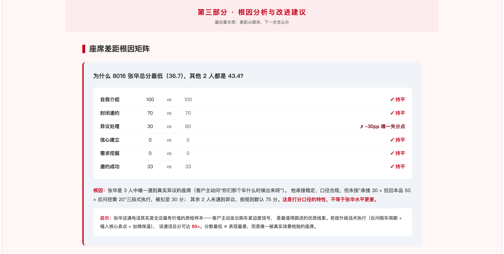
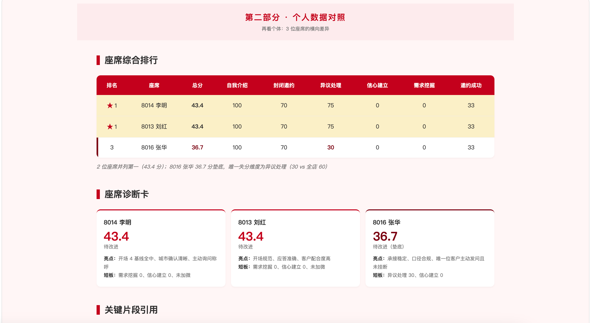
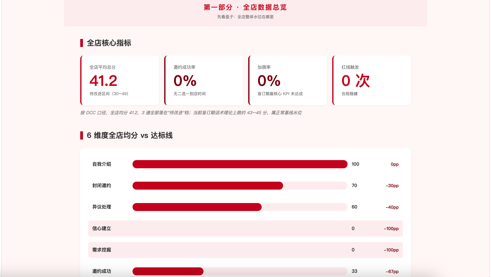

# DCC Zhijian

[中文 README](README.zh.md)

An agent skill for automotive DCC first-contact call quality inspection. It scores call transcripts across 6 dimensions and generates seat-by-seat HTML reports for store-level review.

## Preview

1. Store overview and scoring baseline



2. Agent comparison and key transcript evidence



3. Root-cause analysis and improvement suggestions



Open the live demo page: [DCC Zhijian landing page](https://shanfengai.github.io/dcc-zhijian/)

Open the report example: [DCC quality inspection report](https://shanfengai.github.io/dcc-zhijian/examples/DCC%E8%B4%A8%E6%A3%80%E5%AF%B9%E7%85%A7%E9%95%BF%E5%9B%BE.html)

## What It Does

DCC Zhijian turns automotive outbound-call transcripts into structured quality reports:

- 6-dimension scoring, not gut feeling.
- Batch comparison across agents in the same store.
- Configurable business phase: blind-order, opening, or formal sales period.
- Brand-neutral scoring: brand name, selling points, and benefit words are passed in as configuration.
- Evidence-based diagnosis: scores are tied back to transcript text.

## Install

Tell your agent:

> Install the `dcc-zhijian` skill from `github.com/shanfengai/dcc-zhijian`.

Or install manually:

```bash
git clone https://github.com/shanfengai/dcc-zhijian ~/.codex/skills/dcc-zhijian
```

If your agent uses a different skills directory, clone the repository into that directory instead.

## Use It

```text
DCC 质检一下这段录音文字稿，品牌=XX汽车，阶段=盲订期。
```

```text
把这 5 段录音跑一遍 DCC 质检，都是同一家店的，品牌=XX汽车。
```

```text
3 号工号这通为什么只有 42 分？指出最低维度、原话证据和一句可改的话术。
```

## Scoring Framework

| Dimension | Weight |
|---|---:|
| Self introduction | 15% |
| Closed invitation | 15% |
| Objection handling | 15% |
| Confidence building | 15% |
| Needs discovery | 20% |
| Invitation outcome | 20% |

The report also tracks compliance observations such as over-promising language, weak brand reinforcement, red-line violations, call length, and effective agent speech length.

## Files

- `SKILL.md`: the agent entry point and scoring rules.
- `agents/openai.yaml`: agent metadata.
- `assets/report-template.html`: the locked report layout baseline.
- `examples/DCC质检对照长图.html`: sample generated report.
- `dist/dcc-zhijian.zip`: packaged skill archive.

## License

[MIT](LICENSE)
